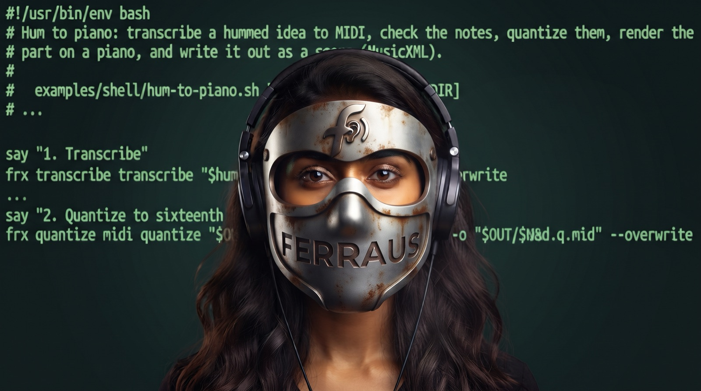

<p align="center"></p>

# ferraus

**A command-line audio workstation for scripts and AI agents.**

One cross-platform binary that edits, repairs, separates, tunes, transcribes, notates, and
masters audio. Every command returns JSON and records how each file was made, so scripts and
agents can chain it without a GUI and reproduce any result. (The *au* is for audio.)

```bash
ferraus separate song.mp3                         # vocals, drums, bass, other
ferraus denoise take.wav --auto -o clean.wav      # learn the noise, remove it
ferraus tune vocal.wav --key auto -o tuned.wav    # pitch-correct to the detected key
ferraus hum idea.wav --to piano -o idea.piano.wav # humming → MIDI → a real instrument
ferraus master mix.wav --target streaming         # release-ready master at -14 LUFS
```

* **Editing and conversion**: convert, trim, cut, split, concat, resample, normalize (EBU R128),
  channels, silence, tags, waveform and spectrogram export; audio from MP4/MKV/WebM/MOV.
* **Effects**: fades, compressor, limiter, gate, de-esser, multiband, EQ, reverb (plate, FDN,
  convolution), delay, chorus/flanger/phaser, saturation, vocoder, panning and automation.
* **Restoration** matching Adobe Audition's effects: declip, dehum, declick, dehiss, spectral
  repair, phase alignment, leveler, scientific filters, and more.
* **Noise reduction** from a noise profile, adaptive, or model-based (DeepFilterNet, RNNoise).
* **Stem separation** in tiers from Demucs to RoFormer ensembles.
* **Pitch and time**: auto-tune, pitch shift with formant preservation, time stretch.
* **MIDI and notation**: quantize, groove, hum-to-MIDI, rendering through SoundFonts, SFZ, or
  CLAP/VST3 instruments; scores (lead sheet, grand staff, drums, solfa) from audio or MIDI, and
  sheet-music PDFs performed as audio.
* **Mastering**: one command, or an analyze → plan → verify loop an agent can drive.

## For AI agents

Every command takes `--json` and returns a stable, versioned envelope; `ferraus schema
<command>` prints its JSON Schema; every output gets a provenance sidecar
(`<output>.ferraus.json`) that `ferraus replay` reproduces. ferraus is also an MCP server:

```bash
claude mcp add ferraus -- ferraus mcp serve --allow ~/music
```

`ferraus describe --agent` prints the whole command surface in under 4,000 tokens. See
[AGENTS.md](AGENTS.md).

## Examples

[examples/](examples/) has runnable shell scripts, pipeline files, an MCP client, and a Claude
agent loop. They work on test audio that ferraus generates, and CI runs all of them.

## Install

| Platform | Command |
| --- | --- |
| macOS and Linux | `curl -fsSL https://github.com/djynnius/ferraus/releases/latest/download/ferraus-installer.sh \| sh` |
| Windows (PowerShell) | `powershell -ExecutionPolicy ByPass -c "irm https://github.com/djynnius/ferraus/releases/latest/download/ferraus-installer.ps1 \| iex"` |
| Homebrew | `brew install djynnius/tap/ferraus` |
| Debian / Ubuntu | `sudo apt install ./ferraus_<version>_amd64.deb` |
| Fedora / RHEL | `sudo dnf install ./ferraus-<version>.x86_64.rpm` |
| Windows | the MSI from the [releases page](https://github.com/djynnius/ferraus/releases) |
| From source | `cargo install ferraus` |

Builds: macOS 13.4+ on Apple silicon and Intel; Linux on x86-64 and ARM64, both with glibc
2.38+ (Ubuntu 24.04+, Debian 13+, Fedora 39+) and as a fully static musl build for Alpine and
older distributions (the shell installer picks it when glibc is too old; it cannot load CLAP or
VST3 plugins); Windows on x86-64 and ARM64 (needs the Microsoft Visual C++ Redistributable,
present on most machines). Release artifacts are built and attested only by this repository's
GitHub Actions workflows. Model weights are
not in the package; they download on first use (with `-y` or `models.auto_download = true`) and
are verified by SHA-256.

Run `ferraus doctor` after installing.

## Documentation

* `ferraus docs <command>` — the full reference page for any command, offline.
* The docs site: <https://djynnius.github.io/ferraus> (and `llms.txt` for models).
* [Product requirements](PRD%20Cross-Platform%20Music%20Editing%20CLI%20(working%20name%20timbre).md),
  [architecture decisions](docs/decisions/), [contributor guide](docs/dev/AUTHORING.md).

## License

Apache-2.0 OR MIT, at your option. The score engraving helper (`ferraus-engrave`) is LGPL-3.0
because it links Verovio; it runs as a separate process.
